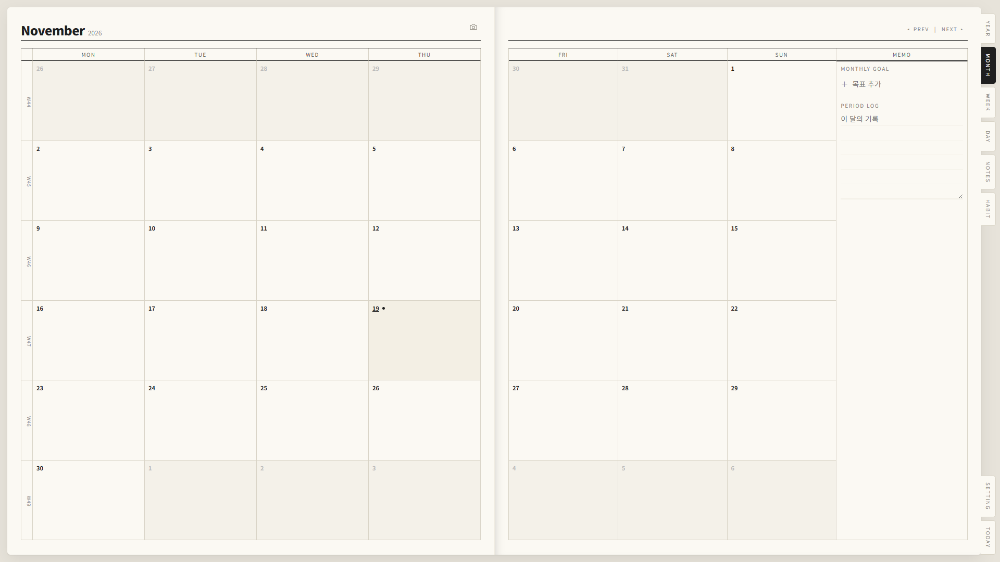
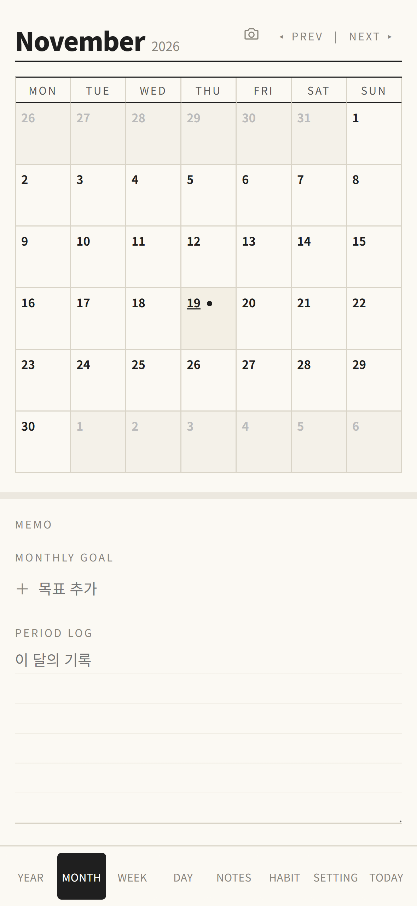
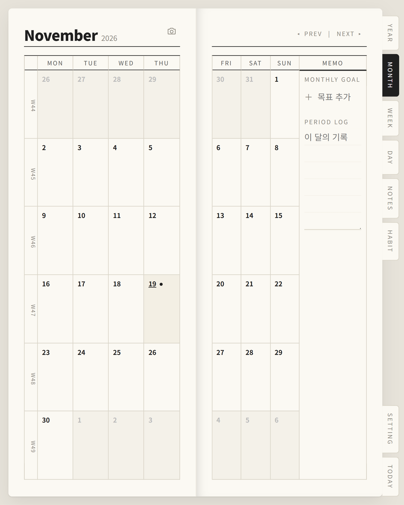
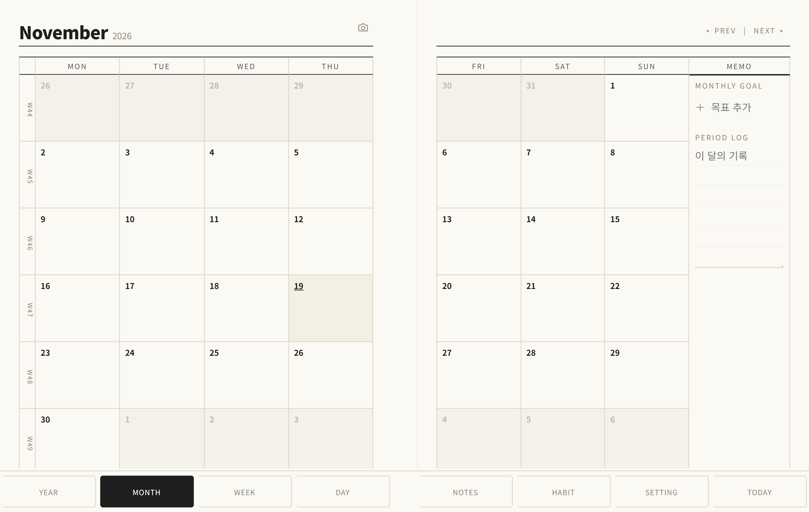

# 트윈 다이어리 (Twin Diary)

연간·월간·주간·데일리·습관·노트를 한 권에 담은 디지털 다이어리입니다. 노션과 구글 캘린더에 연결되고, 아이폰·갤럭시 폴드·플립·듀오·아이패드·갤럭시북·맥·윈도우 어디서나 같은 다이어리를 씁니다.

소스 공개(비상업) · [PolyForm Noncommercial 1.0.0](LICENSE) · 상업적 이용은 허락이 필요합니다 → [COMMERCIAL.md](COMMERCIAL.md)



| 아이폰 | 갤럭시 Z 폴드(펼침) | 두 화면(듀오) |
|---|---|---|
|  |  |  |

---

## 1. 무엇이 필요한가요

쓰는 방법은 두 가지이고, 앱 파일(`index.html`)은 하나입니다.

| | ① 클로드 아티팩트로 쓰기 (권장) | ② 웹앱으로 바로 쓰기 |
|---|---|---|
| 여는 곳 | 클로드 앱·claude.ai | https://heedonggu.github.io/twin-diary/ |
| 기기 간 동기화 | 자동 (같은 클로드 계정) | 없음 — 백업 파일로 옮김 |
| 노션 연결 | 됨 | 안 됨 |
| 구글 캘린더 연결 | 됨 (양방향) | 안 됨 (일정은 기기에 저장) |
| 사진 다이어리 | 아티팩트 저장 공간 | 기기에 작게 줄여 저장(약 5MB까지) |
| 필요한 것 | 클로드 Pro 이상 구독, 노션 계정(무료로 충분), 구글 계정 | 브라우저만 |

노션을 몰라도 됩니다. 앱이 노션에 데이터베이스를 알아서 만들고 채웁니다. 노션 계정만 있으면 됩니다(notion.com에서 메일 주소로 무료 가입).

## 2. 설치 — 클로드 아티팩트

### 2-1. 커넥터 연결 (처음 한 번, 컴퓨터에서)

1. 컴퓨터에서 클로드(데스크톱 앱 또는 claude.ai)를 엽니다.
2. 왼쪽 아래 프로필 → **설정** → **커넥터**로 갑니다.
3. 검색창에 `notion`을 쳐서 **Notion**을 연결합니다.
4. 같은 방법으로 **Google Calendar**를 연결합니다.

### 2-2. 다이어리 설치

1. 이 저장소의 [`index.html`](index.html)을 내려받습니다(파일 열고 오른쪽 위 ⤓ 버튼).
2. 클로드에서 새 채팅을 열고 파일을 첨부한 뒤, 아래 문장을 그대로 붙여 넣어 보냅니다.

```
첨부한 index.html 을 내 아티팩트로 그대로 올려줘. 내용은 고치지 마.
올린 다음 이 아티팩트의 기능을 이렇게 선언해줘:
db, user, assets, downloads,
mcp 커넥터 Notion(notion-create-pages, notion-create-database, notion-update-page, notion-query-data-sources),
Google Calendar(list_events, create_event, update_event, delete_event, list_calendars).
다 되면 링크를 줘.
```

3. 클로드가 링크를 주면 엽니다. 처음 노션·구글 캘린더를 쓸 때 화면 가운데 **“이 아티팩트는 커넥터를 사용합니다”** 창이 뜹니다. 스위치를 켜고 **계속**을 누릅니다.
4. 다이어리 오른쪽 **SETTING** 탭에서
   - **구글 캘린더 → 연동**을 누르고, 쓸 캘린더를 고릅니다(목록 버튼).
   - **노션 → 노션 연결하기**를 누릅니다. 노션에 「트윈 다이어리」 페이지와 그 안에 데이터베이스 5개(Diary · Planner · Notes · Habits · Habit Log)가 생깁니다. 5분이 안 걸립니다.
   - **전부 만들기**를 한 번 누르면 올해부터 2027년 말까지 날짜별·월별·주별 페이지가 노션에 미리 만들어집니다.

사용량은 클로드 구독 한도에서 쓰입니다. 페이지를 한꺼번에 만드는 [전부 만들기]가 가장 많이 씁니다.

### 2-3. 기기별로 여는 법

아티팩트 링크 하나로 모든 기기에서 같은 다이어리가 열립니다. 한 기기에서 쓴 내용은 다른 기기에 바로 보입니다.

| 기기 | 여는 법 |
|---|---|
| 아이폰 · 아이패드 | 클로드 앱 → 아티팩트, 또는 Safari로 링크 열기 → 공유 → **홈 화면에 추가** |
| 갤럭시 폴드 · 플립 · 폴드 울트라 · 듀오 | 클로드 앱, 또는 Chrome으로 링크 열기 → ⋮ → **홈 화면에 추가** |
| 갤럭시북 · 노트북 · 윈도우 PC | 클로드 데스크톱 앱, 또는 Chrome·Edge로 링크 열기 |
| 맥 | 클로드 데스크톱 앱, 또는 Safari·Chrome으로 링크 열기 |

화면 크기에 맞춰 모양이 바뀝니다.

- 폰, 플립, 폴드를 접었을 때: 한 쪽씩 위아래로 넘겨 보고, 탭은 아래에 있습니다.
- 폴드를 펼쳤을 때, 폴드 울트라, 아이패드, 노트북, 맥, 윈도우: 다이어리처럼 두 쪽이 펼쳐지고, 탭은 오른쪽에 세로로 있습니다.
- 듀오처럼 화면이 두 개인 기기에서 양쪽에 걸쳐 열면: 왼쪽 화면에 한 쪽, 오른쪽 화면에 한 쪽이 나오고 경첩 부분은 비워 둡니다.

## 3. 설치 — 웹앱(노션 없이)

1. https://heedonggu.github.io/twin-diary/ 를 엽니다.
2. 앱처럼 설치합니다.
   - 아이폰·아이패드(Safari): 공유 → 홈 화면에 추가
   - 갤럭시(Chrome·삼성 인터넷): 메뉴 → 홈 화면에 추가 / 앱 설치
   - 윈도우·갤럭시북·맥(Chrome·Edge): 주소창 오른쪽 **설치** 아이콘
3. 한 번 열고 나면 인터넷이 없어도 열립니다.

기록은 그 기기의 브라우저에만 저장됩니다. 다른 기기로 옮길 땐 **SETTING → 백업 파일 받기**로 파일을 받고, 새 기기에서 **백업 불러오기**로 엽니다.

## 4. 사용법

오른쪽(폰은 아래) 탭: **YEAR · MONTH · WEEK · DAY · NOTES · HABIT · SETTING · TODAY**. 각 쪽 위의 ◂ PREV | NEXT ▸ 로 앞뒤로 넘깁니다.

**YEAR** — 열두 달의 목표와 일정, 기록한 날 수가 한눈에 보입니다. 달 이름을 누르면 그 달로 갑니다.

**MONTH** — 왼쪽 쪽은 월~목, 오른쪽 쪽은 금~일과 MEMO 칸입니다(일요일 시작이면 일~수 / 목~토).
- 날짜 칸을 누르면 일정을 넣습니다. 구글 캘린더가 연동돼 있으면 구글 캘린더에 바로 들어가고, 구글 캘린더에서 고친 일정은 1분 안에 다이어리에 나타납니다. 일정 옆 [수정]으로 이름·시간을 고치고, ×를 두 번 누르면 지웁니다(구글 일정이면 구글 캘린더에서도 바뀝니다).
- 날짜 숫자를 누르면 그날 데일리로 갑니다. 점(•)은 기록이 있는 날입니다.
- MEMO 칸: **MONTHLY GOAL**(체크리스트) · **PERIOD LOG**(이 달의 기록).
- 카메라 아이콘: 사진 다이어리로 바뀝니다. 날짜를 누르면 그날 사진을 올리고, 오른쪽 칸은 **날짜별 키워드 일기**가 됩니다.

**WEEK** — Week N과 기간, **WEEKLY GOAL**, **PERIOD LOG**, MEMO, 그리고 7일 각각의 일정·할 일·습관 달성 수. 할 일은 여기서 체크해도 데일리에 반영됩니다.

**DAY**
- WAKE UP / IN BED, SLEEP JOURNAL, MORNING NOTE, TO DO, 그날 일정, 습관 체크, 그날 사진
- LOG — 오늘 있었던 일
- **JOY** — 잠깐이라도 웃었던 작은 순간
- **RESET** — 붙잡고 있는 생각을 비우고, 옆에 내가 할 수 있는 작은 일 하나
- **TOMORROW** — 내일은 어떤 사람이 되고 싶은지
- COMMENT
- 다 쓰고 **[노션 저장]**을 누르면 노션 Diary의 속성이 채워집니다. 저장 안 한 내용이 있으면 “노션에 저장 안 됨”이 보이고, 새로고침해도 남아 있습니다. 앱 안의 기록은 누르지 않아도 자동 저장되고, 아래에 “저장됨 / 저장 중… / 저장 실패 — 다시 시도 중”이 보입니다.
- **[노션에서 가져오기]**: 노션에서 직접 고친 내용을 다이어리로 가져옵니다 — Diary 일기, Planner 월·주 목표·기간 기록·메모, Habit Log 체크, Habits 이름·아이콘·분류·켜기, Notes 제목·분류. 화면을 열 때 그 달은 자동으로 한 번 가져옵니다. 이 기기에서 쓰고 아직 노션에 보내지 않은 곳은 덮어쓰지 않습니다. 노트 본문과 노션에서 새로 만든 페이지는 가져오지 않습니다.

**HABIT** — 습관 이름을 쓰고 Enter. 습관을 누르면 아이콘·분류·시작일을 바꾸거나 끕니다. 오른쪽 달력 표나 데일리에서 체크합니다. 위에는 진행 중인 습관 수, 오늘 완료, 이 달 전체 달성률, 가장 긴 연속 기록, 1년 달성 그래프가 있습니다.

**NOTES** — 길게 남기고 싶은 글(책·영화 리뷰, 맛집, 생각). ＋ 새 노트 → 제목·날짜·분류 → 만들기. 연도별 목차(CONTENTS)에 쌓입니다. 노션이 연결돼 있으면 만들 때 바로 노션 Notes에 들어가고, 고치면 노션도 따라 바뀝니다. 분류는 SETTING에서 바꿉니다.

**SETTING** — 저장 위치, 백업, 한 주의 시작(월/일), 사진 기능 켜기·끄기, 노트 분류, 구글 캘린더, 노션.

### 노션에 들어가는 것

| 노션 데이터베이스 | 언제 | 내용 |
|---|---|---|
| Diary | 데일리 [노션 저장] | 날짜, Wake Up, In Bed, Sleep Journal, Morning Note, To do, Event, Habits, Log, Joy, Reset, Tomorrow, Comment |
| Planner | 월간·주간 목표·기록을 바꿀 때 자동 | Month/Week, 목표 체크 상태, Period Log |
| Habits | 습관을 만들거나 바꿀 때 자동 | 이름, 아이콘, 분류, 시작일, 켜짐 |
| Habit Log | 습관을 체크할 때 자동 | 날짜, 체크한 습관, 개수 |
| Notes | 노트를 만들거나 고칠 때 자동 | 제목, 날짜, 분류, 본문 |

## 5. 알아 둘 점

- 사진은 노션에 들어가지 않습니다. 아티팩트(또는 기기) 안에만 저장되고, 저장 공간에 한도가 있어 사진을 끝없이 넣을 수는 없습니다.
- 애플 캘린더는 바로 연결되지 않습니다. 아이폰 설정에서 애플 캘린더를 구글 계정과 동기화하면 구글 캘린더를 통해 보입니다.
- 다이어리의 원본은 클로드 계정 저장소이고 노션은 함께 채워지는 사본입니다. 그래서 노션 로딩을 기다리지 않고 모든 기기에서 바로 열립니다. 노션에서 고친 일기·목표·습관·노트 제목은 [노션에서 가져오기]로 돌아옵니다. 노트 본문은 다이어리 쪽에서 고쳐 주세요.
- 두 기기에서 같은 달의 다른 날을 동시에 써도 날짜별로 저장되어 서로 덮어쓰지 않습니다.
- 커넥터 연결이 끊기면 그 이유(다시 연결, 커넥터 추가, 허용 필요)를 화면 아래에 알려 줍니다.

## 6. 내 마음대로 고치기

클로드에서 이 아티팩트를 열고 **채팅하기**를 눌러 바꾸고 싶은 점을 말하면 됩니다. 처음부터 만드는 것보다 훨씬 쉽습니다.

- “월간 칸에 음력도 보이게 해줘”
- “데일리에 오늘의 감사 3가지 칸을 넣어줘”
- “이 스타일 그대로 가계부 아티팩트를 만들어줘” (업무일지·스크랩북도 됩니다)

## 7. 개발·시험

앱은 `index.html` 한 파일입니다(빌드 도구·라이브러리 없음). 같은 파일이 아티팩트로도, 웹앱으로도 돌아갑니다.

```bash
npm install
npx playwright install chromium
node test/e2e.mjs
```

시험은 실제 브라우저로 단독 실행(A), 클로드 아티팩트 실행환경과 노션·구글 캘린더 호출 내용(B), 배포 규격·설명서(C), 기기 12종 + 두 화면 기기(D)를 확인합니다. 브라우저는 `CHROME_PATH`가 있으면 그것을, 없으면 Playwright가 설치한 Chromium을 씁니다. 기능 목록과 시험 대응표는 [`audit/CHECKLIST.md`](audit/CHECKLIST.md)에 있습니다.

## 라이선스

소스 공개(비상업) — [PolyForm Noncommercial 1.0.0](LICENSE). OSI 오픈소스 라이선스가 아닙니다. 상업적 이용·상품화는 허락이 필요하며, 저장소에 기여하거나 트윈솔루션과 함께 개발하는 방식으로 허락합니다 → [COMMERCIAL.md](COMMERCIAL.md) · [CONTRIBUTING.md](CONTRIBUTING.md)

만든 곳: 트윈솔루션
